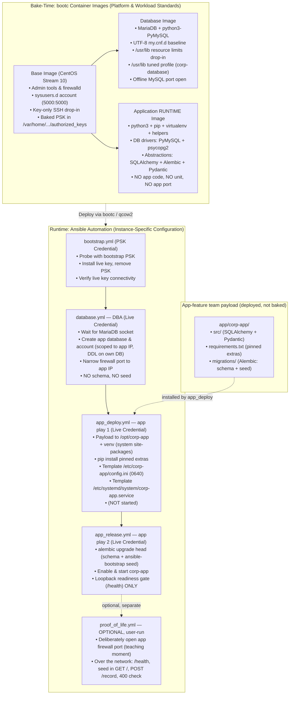
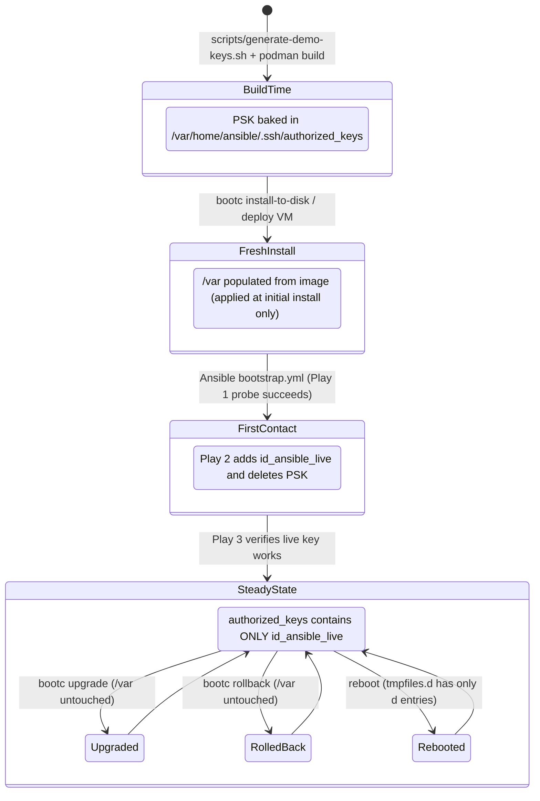

# bootc + Ansible Reference Pattern

A reference implementation showing the correct division of responsibility between
**bootc** (image-mode Linux, CentOS Stream 10) and **Ansible** for a corporate
standard: how a MariaDB server runs, and how a reusable corporate **Python runtime
baseline** hosts an application that is *deployed onto* it — not baked into it.
Optimised for clarity as a teachable pattern — simple and explicit, not production
automation.

The application image is a **runtime baseline**, not an app image: it bakes the
corporate Python stack (DB drivers + SQLAlchemy/Alembic/Pydantic) and no application
code. The app — its source, its pinned extras, and its Alembic migrations — is a
payload Ansible installs to `/opt/corp-app`. Deployment is separated from
demonstration: the app teams own two plays (deploy, then release/go-live), and all
functional verification lives in a separate, optional **proof-of-life** exercise.

---

## Table of Contents

1. [Architecture Overview](#1-architecture-overview)
2. [Image Layering and Repository Structure](#2-image-layering-and-repository-structure)
3. [PSK Lifecycle](#3-psk-lifecycle)
4. [Key Generation → Image Build Ordering](#4-key-generation--image-build-ordering)
5. [Setup and Execution](#5-setup-and-execution)
6. [Practitioner Notes](#6-practitioner-notes)
7. [AAP Compatibility](#7-aap-compatibility)

---

## 1. Architecture Overview

### Target audience and presumed familiarity

This reference pattern is written for an enterprise Linux systems administrator:

- **Traditional Automation (Assumed Fluent)**: You are experienced with RHEL administration, Ansible (roles, playbooks, inventory, vault), systemd, SSH, and firewalld. The repository does not explain basic playbook syntax or service drop-ins; it audits and implements them to senior enterprise standards.
- **Image-Mode Linux (Assumed First Contact)**: You are encountering **bootc** and image-mode Linux for the first time. The repository actively bridges your mental model: teaching the bake-time vs. runtime boundary, `/usr`/`/etc`/`/var` filesystem semantics, and how traditional golden-image concepts map into bootable container images.
- **Automation Platform (Conceptual)**: You have a working familiarity with Red Hat Ansible Automation Platform (AAP) concepts like Job Templates and Machine Credentials.

#### Familiar by assumption (enterprise baseline — never re-taught)

| Technology | Assumed level | How it shapes this project |
|---|---|---|
| **Ansible** | Expert / Fluent | Roles, task idempotency, `group_vars` precedence, vault encryption, handlers, collections. Playbook syntax and handler mechanics are taken as given. |
| **SSH** | Expert | Key modes (`0600`), `authorized_keys` options tokens (`no-pty`, forwarding controls), fingerprint-based key matching. |
| **systemd** | Expert | Unit drop-ins, `systemctl edit`, sandboxing directives (`NoNewPrivileges`, `ProtectSystem`), `sysusers.d`, and `tmpfiles.d`. |
| **firewalld** | Expert | Zones, rich rules, and runtime vs. permanent state. Only the build-time offline tool (`firewall-offline-cmd`) is treated as new. |
| **PAM & Linux OS** | Working Knowledge | Session flow, limits (`limits.d` vs. systemd service drop-ins), standard RHEL administration. |

#### First contact / low familiarity (the pedagogical frontier)

| Technology | Assumed level | How it shapes this project |
|---|---|---|
| **bootc / Image-Mode** | Day-1 Explorer | Actively taught: immutable `/usr`, 3-way merge `/etc`, install-only `/var`, the `/home` → `/var/home` symlink, and image upgrade/rollback semantics. |
| **Containers as OS Images** | Beginner | Application containers may be familiar, but using a Containerfile to build an entire bootable OS image is treated as novel. The `rootfs/` mirror-tree is used to bridge this. |
| **ostree Deployment Semantics** | Zero | Atomic updates, staged deployments, and rollback survival are explained and diagrammed. |
| **Ansible Automation Platform** | Intermediate | Conceptual familiarity with Job Templates and Machine Credentials; credential-isolation constraints under AAP are documented. |

### The bake-time / runtime boundary

The central design question is: *which system owns each piece of configuration?*
This project answers with a single rule:

| Configuration kind | Owner | Mechanism |
|--------------------|-------|-----------|
| Platform standard (SSH policy, management account, firewall baseline) | Base bootc image | `COPY rootfs/ /` in the Containerfile |
| Workload standard (MariaDB resource limits, tuned profile, corporate DB config; corporate Python runtime stack) | Workload bootc image | `COPY rootfs/ /` and baked packages in the workload Containerfile |
| Application payload (code, pinned extras, Alembic migrations) | App-feature team | Deployed by Ansible to `/opt/corp-app` (`app_deploy`) — never baked |
| Instance-specific runtime state (database credentials, app config, live SSH key, app schema) | Ansible | Roles: `mariadb_instance`, `app_deploy`, `app_release`, `bootstrap_key_rotation` |

Anything that is **the same on every host running this image** lives in the image.
Anything that **differs between hosts** or **must not exist until after first contact**
lives in Ansible.

### The three-tier configuration domain rule

```
Platform standard  →  base image       (time sync, SELinux posture, firewall policy)
Workload standard  →  workload image   (MariaDB tuning, app unit, corporate DB config)
Instance-specific  →  Ansible          (credentials, live SSH key, runtime config)
```

Configuration domains where the workload answer is the same as the platform answer —
time sync, SELinux posture, global firewall policy — are **base-only**: no workload
image overrides them.

### Why the boundary is drawn where it is

**bootc's `/usr` is immutable at runtime.** Service unit files, executables, sysusers
and tmpfiles declarations, and tuned profiles all live under `/usr/lib`. They update
atomically when the image updates and cannot be edited on a running host. The corporate
standard for *how MariaDB runs* (file-descriptor limits, character set, tuned profile)
lives here so that a `bootc upgrade` automatically propagates it to every host in the
fleet without a separate configuration management run.

**bootc's `/etc` is machine-local config subject to 3-way merge.** The SSH hardening
drop-in, the MariaDB baseline `cnf`, and the application runtime config land here.
Ansible writes instance-specific values (credentials, database host pointer) into
`/etc`; a `bootc upgrade` merges them so local changes survive.

**bootc's `/var` is persistent machine state and first-contact state.** In bootc systems,
`/home` is a symlink to `/var/home` so user data resides on the persistent `/var` volume.
This is why all management account paths reference `/var/home/ansible/`.

Two critical operational guarantees rest on bootc's install-only `/var` semantics:
1. **The pre-shared bootstrap key (PSK) cannot resurrect**: bootc applies `/var` content from
   the image *only* at initial install — it is never re-applied or merged by `bootc upgrade`
   or `bootc rollback`. Once Ansible deletes the PSK, nothing can restore it.
2. **Database data survives updates and rollbacks**: `/var/lib/mysql` is preserved untouched
   across `bootc upgrade` and rollback by the exact same mechanism. The image never overwrites
   existing `/var` data. The guarantee that prevents the PSK from resurrecting is the exact
   same guarantee that keeps your database data safe.

### Bridging traditional automation to image mode

For sysadmins migrating existing monolithic Ansible playbooks, configuration tasks split
across the new boundary as follows:

| Traditional Ansible Task | Where it moves in this pattern | Why |
|---|---|---|
| `dnf`/`package` installation tasks | Containerfile `RUN dnf install` | Packages live in immutable `/usr`; no package manager runs at runtime |
| Base OS hardening (SSH, sudoers) | Base image `rootfs/etc/` | Applied identically across all fleet hosts at bake time |
| Management user creation | Base image `usr/lib/sysusers.d/` | Idempotent, drift-free boot-time account creation with pinned UID/GID |
| Service units & resource limits | Workload image `usr/lib/` | Image-owned standard; updates atomically with image upgrades |
| Service baseline config (`my.cnf.d`) | Workload image `rootfs/etc/` | Seeded at install time; merges cleanly via bootc 3-way merge |
| Firewall port baseline | Workload image (`firewall-offline-cmd`) | Offline baseline opened during container build |
| Runtime firewall narrowing (rich rules) | Ansible (`ansible.posix.firewalld`) | Instance-specific; restricts DB access to application VM IP |
| Application code + Python extras | Ansible (`app_deploy`: payload to `/opt/corp-app`, pip into venv) | App is a payload on the runtime baseline; pinned extras only |
| Application schema & migrations | Ansible (`app_release`: Alembic from the venv) | App owns its schema; DBA provides the empty database |
| Application config & credentials | Ansible (templates & vault in `/etc`) | Instance-specific state that differs across environments |
| Service unit file | Ansible (`app_deploy`: template to `/etc/systemd/system`) | Instance-owned unit; not baked into the image |
| Service start and enablement | Ansible (`app_release`: `ansible.builtin.systemd`) | Deferred until payload, config, and schema are in place |
| External firewall exposure | Ansible, deliberate separate step (`proof_of_life`) | Default-deny until a human explicitly exposes the service |

### Visualizing the architecture



---

## 2. Image Layering and Repository Structure

### Image layering is the team boundary

```
quay.io/centos-bootc/centos-bootc:stream10
    └── corp-base:latest          ← platform/security team
          ├── corp-db:latest      ← database workload team (DBA / DB-platform)
          └── corp-app:latest     ← application RUNTIME baseline (app-platform / runtime team)
```

Layering via `FROM corp-base:latest` is the organisational boundary: the platform
team owns the base image; workload teams derive from it. No multi-stage Containerfile
builds are needed — nothing is compiled. Each layer adds only what its workload requires.

Note the ownership nuance on the application side: the **app-platform/runtime team** owns
the `corp-app` runtime baseline (the corporate Python stack), while the **app-feature
team** owns the application payload deployed onto it (`app/corp-app/` → `/opt/corp-app`).
The image answers "what Python runtime does every app host get?"; the payload answers
"what is *this* app?".

### The `rootfs/` mirror-tree convention

Image directories that ship baked configuration contain a `rootfs/` subtree that mirrors
the target filesystem. The single Containerfile step `COPY rootfs/ /` copies it all in one
layer. This convention makes the build context the documentation of what lands where on a
deployed system — you can navigate `images/base/rootfs/` to understand the deployed state
without reading Containerfile logic.

The **application runtime image is the deliberate exception**: it has no `rootfs/` because it
bakes no files of its own beyond the packages it installs — it is a pure runtime baseline.
Everything app-specific is a payload Ansible deploys to `/opt/corp-app` at runtime.

```
images/base/rootfs/
├── etc/
│   ├── sudoers.d/99-ansible                          → /etc/sudoers.d/99-ansible
│   └── ssh/sshd_config.d/50-corporate-hardening.conf → /etc/ssh/sshd_config.d/
├── var/
│   └── home/ansible/.ssh/authorized_keys            → PSK, first-contact only
└── usr/lib/
    ├── sysusers.d/ansible.conf                       → management account, UID 5000
    └── tmpfiles.d/ansible-home.conf                  → home dir (d entries only)
```

### Repository layout

```
ansible-bootc/
├── README.md
├── docs/
│   ├── plan.md                               Requirements and design decisions
│   └── design-spec.md                        Technical design specification
├── scripts/
│   ├── setup-demo-host.sh                    Automated local demo setup (host packages, libvirt, VMs)
│   └── generate-demo-keys.sh                 MUST run before any image build
├── images/
│   ├── base/
│   │   ├── Containerfile
│   │   └── rootfs/                           Mirrors /; COPY rootfs/ / installs all
│   │       ├── etc/sudoers.d/99-ansible
│   │       ├── etc/ssh/sshd_config.d/50-corporate-hardening.conf
│   │       ├── var/home/ansible/.ssh/authorized_keys   ← gitignored, generated
│   │       └── usr/lib/
│   │           ├── sysusers.d/ansible.conf
│   │           └── tmpfiles.d/ansible-home.conf
│   ├── database/
│   │   ├── Containerfile
│   │   └── rootfs/
│   │       ├── etc/my.cnf.d/00-corporate.cnf
│   │       └── usr/lib/
│   │           ├── systemd/system/mariadb.service.d/10-corporate.conf
│   │           └── tuned/corp-database/tuned.conf
│   └── application/                          Corporate Python RUNTIME baseline
│       └── Containerfile                     No rootfs/: bakes no app code or unit
├── app/                                      App-feature team payload (deployed to /opt/corp-app)
│   └── corp-app/
│       ├── requirements.txt                  App-specific pinned EXTRAS only
│       ├── src/                              Application package (SQLAlchemy + Pydantic)
│       └── migrations/                       Alembic tree (app-owned schema + seed)
└── ansible/
    ├── ansible.cfg                           Run from ansible/ directory
    ├── requirements.yml                      ansible.mariadb, ansible.posix
    ├── site.yml                              Deployment entrypoint (bootstrap → database → app_deploy → app_release; NOT proof-of-life)
    ├── inventory/
    │   ├── hosts.yml                         db01, app01 — update IPs here
    │   └── group_vars/
    │       ├── all/vars.yml                  Shared non-sensitive vars
    │       ├── all/vault.yml                 app_db_password (vault-encrypted)
    │       ├── database/vars.yml             app_host_address
    │       └── application/vars.yml          db_host, app_port, app_root/app_venv/app_src/app_entrypoint
    ├── keys/                                 Generated key material — all gitignored
    ├── playbooks/
    │   ├── bootstrap.yml                     PSK probe → rotation → live key verify
    │   ├── database.yml                      DBA: DB foundation (no schema/seed)
    │   ├── app_deploy.yml                    App play 1: payload/venv/config/unit
    │   ├── app_release.yml                   App play 2: migrate + start + readiness gate
    │   ├── proof_of_life.yml                 On-host verification: health, read, write
    │   └── expose_app.yml                    Operator action: open external firewall port
    └── roles/
        ├── bootstrap_key_rotation/           PSK → live key rotation
        ├── mariadb_instance/                   DB + account + firewall narrowing (schema-free)
        ├── app_deploy/                       Payload, venv, pinned extras, config, unit
        ├── app_release/                      Alembic migrate, enable/start, readiness gate
        └── app_proof_of_life/                Network functional verification (exercise)
```

---

## 3. PSK Lifecycle

The pre-shared bootstrap key (PSK) is the sole mechanism for reaching a freshly
provisioned, never-onboarded host. Its lifecycle is invariant:

| Phase | `authorized_keys` state | Mechanism |
|-------|------------------------|-----------|
| Image build | PSK entry (with restrictive options), owned `5000:5000`, mode `0600` | `scripts/generate-demo-keys.sh` writes the file; Containerfile sets ownership/mode |
| First boot | PSK entry present and usable | bootc applies `/var` tree at initial install only |
| After `bootstrap.yml` | Live key only; PSK absent | `bootstrap_key_rotation` role installs live key, removes PSK |
| `bootc upgrade` | Unchanged (live key only) | `/var` is never merged or re-applied by bootc upgrade |
| Reboot | Unchanged | `tmpfiles.d` has only `d` entries for `.ssh/`; existing files are not recreated |
| Re-run `bootstrap.yml` | Unchanged | Play 1 probe fails (PSK gone); Play 2 skipped; Play 3 verifies live key still works |
| Stale host (old image, new PSK generated) | Cannot be onboarded | Decommission and reprovision; never rescued |

**Re-run console output note:** When re-running `bootstrap.yml` against an already-onboarded
host, Play 1's recap will report `unreachable=1` in red. **This is expected and designed behavior**:
because the PSK was removed at first contact, probing with the bootstrap key fails authentication.
The task specifies `ignore_unreachable: true`, which skips Play 2's rotation and allows Play 3 to
verify live-key connectivity. The UNREACHABLE status in Play 1 is the discriminator, not an outage.

**Why not cloud-init?** Cloud-init or metadata services are common in public clouds for initial key
injection. The baked-PSK pattern is valuable where cloud-init is unavailable, undesirable, or
fragmented: air-gapped environments, bare-metal physical servers, or heterogeneous hypervisors.
It exploits bootc's native install-only `/var` semantics to guarantee first-contact-only access
with zero external agents or boot-time infrastructure.



```text
  Phase:           Image Build        First Boot          First Contact (Ansible)    Day-2 (Upgrades / Rollback)
                  ─────────────      ────────────        ────────────────────────    ───────────────────────────
  Host /var:      [PSK baked]   ──►  [PSK unpacked]  ──► [PSK removed, Live added] ──► [Live key retained; /var untouched]
                                                                  ▲
  Ansible Node:   [Keys generated]   [Wait for IP]   ──► [bootstrap.yml runs]   ──► [Subsequent plays use Live key]
```

### No resurrection path

After rotation, **nothing re-creates the PSK entry** — not upgrades, not reboots,
not re-running playbooks. The only way to restore first-contact behaviour is a fresh
provisioning from the image (which re-applies `/var`). This is the "install-only `/var`
semantics" guarantee.

### Restrictive SSH options on the PSK line

The PSK entry in `authorized_keys` carries four SSH option tokens:

```
no-pty,no-X11-forwarding,no-agent-forwarding,no-user-rc ssh-ed25519 AAAA...
```

These limit what the shared provisioning key can do:

| Option | Restriction |
|--------|-------------|
| `no-pty` | No interactive terminal — Ansible's non-interactive command execution does not require one |
| `no-X11-forwarding` | No X11 session forwarding |
| `no-agent-forwarding` | No SSH agent forwarding |
| `no-user-rc` | Do not execute `~/.ssh/rc` on login |

Ansible's `authorized_key` module matches keys by fingerprint and correctly identifies
and removes the PSK entry even though it carries this options prefix.

### Expected `bootc container lint` warning

Running `bootc container lint` on the base image will produce a warning about content
under `/var`:

```
WARN: Image contains content under /var — bootc expects /var to be managed at
      runtime by the host, not baked into the image.
```

**This warning is intentional, not a defect.** (Note: exact phrasing varies across
`bootc container lint` toolchain releases; any warning flagging files or content under `/var`
references this intentional PSK placement). The PSK must live under `/var` because
that is the only bootc filesystem zone with "applied at initial install only, never
re-applied on upgrade" semantics — exactly what the first-contact-only lifecycle
requires. The alternatives (tmpfiles.d `f~` entry, `/etc` with Ansible cleanup) all
introduce a resurrection path that would defeat the guarantee. The warning is documented
here so operators know to expect it and need not investigate.

---

## 4. Key Generation → Image Build Ordering

**The key generation script must run before any image build.** This is a hard ordering
constraint, not a suggestion:

```
scripts/generate-demo-keys.sh       ←  MUST come first
    ↓
podman build -t corp-base:latest images/base/
    ↓
podman build -t corp-db:latest images/database/
podman build -t corp-app-img:latest images/application/
```

**Why the order matters:** `scripts/generate-demo-keys.sh` writes the bootstrap public
key into `images/base/rootfs/var/home/ansible/.ssh/authorized_keys`. The base
Containerfile copies that file into the image layer (`COPY rootfs/ /`). If you build
the image first and generate the keys after, the image contains no `authorized_keys`
file (the build actually fails with an explicit error) — or worse, if a previous
`authorized_keys` was present, the image and the Ansible key material are out of sync
and newly provisioned hosts cannot be onboarded.

**What happens if you regenerate keys after provisioning:** Any host already provisioned
from an image built with the old PSK becomes unreachable with the new bootstrap key.
The script guards against this by refusing to overwrite existing keys:

```
ERROR: Keys already exist in ansible/keys/.
       Regeneration would invalidate all images built with the current
       bootstrap key. Hosts provisioned from those images cannot be
       onboarded with a new PSK and must be decommissioned and
       reprovisioned from a freshly built image.
```

---

## 5. Setup and Execution

All steps from a fresh checkout to a running system, in order.

> **💡 Fast Path (Automated Local Demo):** If you are running on a local RHEL/CentOS KVM host
> with libvirt, `bash scripts/setup-demo-host.sh` automates Steps 1 through 4: host packages,
> keys, vault generation, image builds, qcow2 conversion, VM launch, and auto-populating
> `hosts.yml` with the dynamic DHCP IPs. You can then jump directly to **Step 5**.
> The manual walkthrough below explains what the script does and is the canonical procedure
> for non-libvirt environments.

### Step 1 — Generate the demo key pairs

Run from the repository root:

```bash
# Working directory: repo root (ansible-bootc/)
bash scripts/generate-demo-keys.sh
```

This generates four files in `ansible/keys/`:

```
ansible/keys/id_bootstrap       Private bootstrap (PSK) key — Ansible bootstrap credential
ansible/keys/id_bootstrap.pub   Public bootstrap key — written into the base image
ansible/keys/id_live            Private live management key — all post-bootstrap access
ansible/keys/id_live.pub        Public live key — installed by bootstrap_key_rotation role
```

All four files are gitignored.

### Step 2 — Build the images

Build in order: base first, then database and application (both depend on the base tag):

```bash
# Working directory: repo root (ansible-bootc/)
podman build -t corp-base:latest images/base/
podman build -t corp-db:latest images/database/
podman build -t corp-app:latest images/application/
```

### Step 3 — Provision VMs

Converting bootc images to qcow2 disk images and provisioning libvirt VMs is known
procedure and is out of scope for this repository. Use `bootc-image-builder` or the
equivalent for your environment:

```bash
# Example only — adapt to your environment
sudo podman run --rm --privileged \
    --volume /var/lib/containers/storage:/var/lib/containers/storage \
    quay.io/centos-bootc/bootc-image-builder:latest \
    --type qcow2 \
    quay.io/yourrepo/corp-db:latest
```

Provision one VM for the database host and one for the application host, noting their
IP addresses.

### Step 4 — Update the inventory

Edit the inventory to match your VM addresses:

```bash
# Working directory: repo root (ansible-bootc/)
# Edit ansible/inventory/hosts.yml
# Edit ansible/inventory/group_vars/database/vars.yml   — set app_host_address
# Edit ansible/inventory/group_vars/application/vars.yml — set db_host
```

The IP of `app01` and `app_host_address` must be identical. The IP of `db01` and
`db_host` must be identical. A divergence breaks the database account host restriction
and the config template silently.

### Step 5 — Install Ansible collections

All subsequent Ansible commands must be run from the `ansible/` directory. Paths
in `ansible.cfg` are relative to that directory; running from the repo root causes
path-resolution failures.

```bash
# Working directory: ansible/
cd ansible/
ansible-galaxy collection install -r requirements.yml
```

### Step 6 — Create the vault password file and encrypt the vault

```bash
# Working directory: ansible/
# Create a vault password file (gitignored)
echo 'your-strong-random-passphrase' > keys/.vault_pass
chmod 0600 keys/.vault_pass

# Edit the vault file to set app_db_password, then encrypt it
# The vault file is at inventory/group_vars/all/vault.yml
ansible-vault encrypt inventory/group_vars/all/vault.yml

# Also encrypt the placeholder vault files for the host groups (optional)
# These files are empty placeholders for future group-specific secrets.
# Encrypting them is optional; they contain no sensitive values in this reference pattern.
ansible-vault encrypt inventory/group_vars/database/vault.yml
ansible-vault encrypt inventory/group_vars/application/vault.yml
```

The `all/vault.yml` file contains `app_db_password`. This is the only place this
variable may appear (the shared secret rule): it must be visible to the `mariadb_instance` role
(database group, which creates the account) and to the `app_deploy`/`app_release` roles
(application group, which render it into the config and use it as the Alembic migration
credential), which requires placement in `all/` rather than any group-specific vault.

### Step 7 — Run the deployment sequence

**Standalone (single invocation):**

```bash
# Working directory: ansible/
ansible-playbook site.yml
```

`site.yml` imports the four deployment playbooks in sequence:

1. `playbooks/bootstrap.yml` — PSK probe → key rotation → live key verify (platform)
2. `playbooks/database.yml` — DB foundation: database, account, firewall narrowing (DBA; no schema/seed)
3. `playbooks/app_deploy.yml` — app play 1: payload to `/opt/corp-app`, venv, pinned extras, config, unit (not started)
4. `playbooks/app_release.yml` — app play 2: Alembic migrate (schema + seed), enable/start, loopback readiness gate

**Or run individually:**

```bash
# Working directory: ansible/
ansible-playbook playbooks/bootstrap.yml
ansible-playbook playbooks/database.yml
ansible-playbook playbooks/app_deploy.yml
ansible-playbook playbooks/app_release.yml
```

### Step 8 — Test, Troubleshoot, and Expose

Follow the operator workflow to experience the default-deny firewall posture:

1. **Attempt external curl (Expected to fail):**
   ```bash
   # From your control node terminal:
   curl -s --max-time 3 http://app01:8080/health || echo "Blocked by firewall (Expected default-deny)"
   ```
   *The connection times out because the application host enforces the corporate security baseline firewall posture inherited directly from `corp-base` (which opens SSH only).*

2. **Verify host connectivity (Is the VM alive?):**
   ```bash
   ping -c 1 app01
   ```
   *The ping returns immediately. This proves `app01` is online, network routing is intact, and `libvirt-nss` is actively resolving the hostname — isolating the failure directly to the host's firewall.*

3. **Verify app-to-database on the host (Proof of Life):**
   Run the verification playbook against `app01` to confirm the application is healthy and actively communicating with MariaDB:
   ```bash
   # Working directory: ansible/
   ansible-playbook playbooks/proof_of_life.yml
   ```
   *All checks succeed on-host over loopback (health connected, seed visible, live write probe, input validation).*

4. **Troubleshoot the firewall:**
   The host is reachable via ICMP, the application is healthy on loopback, and it communicates with MariaDB — so why did external `curl` fail? The application host is running the corporate security baseline firewall posture inherited from `corp-base`, which opens SSH only. Port 8080 has not yet been exposed by the operator.

5. **Expose the port:**
   Run the operational exposure playbook to open port 8080:
   ```bash
   # Working directory: ansible/
   ansible-playbook playbooks/expose_app.yml
   ```

6. **Test again from your workstation:**
   Now external network traffic reaches the application:
   ```bash
   curl -s http://app01:8080/health | jq .
   curl -s http://app01:8080/ | jq .
   ```

---

## 6. Practitioner Notes

### Team split: layering is the boundary

The `FROM corp-base:latest` line in the database and application Containerfiles is
literally the team boundary in code. The platform/security team publishes `corp-base`;
workload teams pull from it and add their layer. No multi-stage build stages are
needed — nothing in this pattern is compiled, so there is no "build artefact"
separation requirement. The layered `FROM` is the full story.

On the application side there is a second boundary *inside* the layer: the
**app-platform/runtime team** owns the `corp-app` runtime baseline (the corporate Python
stack), while the **app-feature team** owns the payload (`app/corp-app/`) that Ansible deploys to
`/opt/corp-app`. The image answers "what runtime does every app host get?"; the payload answers
"what is this app?". The DBA/DB-platform team owns `corp-db` and the DB foundation play.

### Corporate Python standard: one runtime, few choices

The application image is a **reusable corporate Python runtime baseline**. It bakes, in one place,
the stack every app host inherits:

- **Core runtime:** `python3`, pip, virtualenv, ca-certificates, tzdata.
- **Helpers & packaging:** git, tar, gzip, unzip, setuptools, wheel.
- **Corporate DB drivers:** `python3-PyMySQL` (MariaDB/MySQL) and `python3-psycopg2` (PostgreSQL)
  — two drivers on purpose, signalling a centrally-standardized runtime rather than per-app driver
  choices.
- **Corporate data-abstraction layer:** SQLAlchemy, Alembic, Pydantic.

App teams make as few choices as possible: they inherit the whole stack through a venv built with
`--system-site-packages` and declare only *app-specific* extras in `app/corp-app/requirements.txt`,
always pinned. There is one source of truth for shared Python infrastructure (the image) and one
small place for per-app decisions (the extras file). Changing the corporate stack is an image
rebuild + `bootc upgrade`, governed by the runtime team — not an ad-hoc per-host pip install.

### Standard deployment target: `/opt/corp-app`

Applications deploy to `/opt/corp-app`, with the virtualenv at `/opt/corp-app/venv`, config at
`/etc/corp-app/config.ini`, and the unit at `/etc/systemd/system/corp-app.service`.

**How bootc handles `/opt` cleanly:** In bootc the root filesystem (`/`) is mounted read-only.
Rather than modifying the system-level `/opt` root directory, the application runtime image
follows the documented bootc pattern ("symlink just the parts of `/opt` needed into `/var`"):
it creates `/var/opt/corp-app` on persistent storage and links `/opt/corp-app -> /var/opt/corp-app`.
This gives Ansible a writable, persistent deployment target on `/var` that survives upgrades and
rollbacks (just like `/var/lib/mysql`) while preserving standard FHS path expectations for
systemd and operators without any root filesystem workarounds.

### Deploy vs. release vs. proof-of-life

Deployment is split from demonstration on purpose:

- **`app_deploy.yml` (app play 1, "deploy"):** lay the payload down — install to `/opt/corp-app`,
  build the venv, install pinned extras, render config and the unit. Nothing is started; no schema;
  no port opened.
- **`app_release.yml` (app play 2, "release/go-live"):** run the app's Alembic migrations (schema +
  `ansible-bootstrap` seed), enable and start the service, and confirm liveness with a single
  **loopback readiness gate** (`/health`). No functional exercises here.
- **`proof_of_life.yml` (optional, user-run):** the deliberate firewall-exposure step followed by
  real functional verification **over the network** (health, seed visibility, a write, and a
  malformed-input rejection). This is where "does it actually work for a user?" is answered, and it
  is never part of `site.yml`.

This mirrors a real CI/CD deploy → release → smoke-test flow, and keeps write-probes and other
non-idempotent demonstration side effects out of the convergent deployment path.

### Database privilege scope: the app owns its schema

The DB foundation role (`database.yml`, DBA-owned) creates the application database and an account
scoped to **that database only**, granting it the DDL (CREATE/ALTER/DROP) its migrations need plus
the usual DML. It creates **no** tables and **no** seed data. The app team then owns its schema
end to end via Alembic (run in `app_release.yml`).

**This is a deliberate, flagged simplification — read it as a lesson, not a recommendation.** This
repo is an *example*, not a template to clone into production. A single account means the
long-running, network-exposed `corp-app` service holds a credential that can `DROP`/`ALTER` its own
schema — even though the service itself only ever runs `SELECT` and `INSERT`. That gap between *what
the account is granted* and *what the running service actually uses* is the least-privilege lesson,
and it is called out here (and in the role's own task comments) precisely so it is never copied
silently.

**The production posture** separates two credentials on the same database:

| Credential | Privileges | Used by | Lifetime |
|------------|-----------|---------|----------|
| Migration / schema-owner | DDL + DML | Alembic, at release time only | Ideally ephemeral — passed at `app_release.yml` run time, never persisted on the host |
| Runtime | Least privilege (here, `SELECT, INSERT`) | the running `corp-app` service | Long-lived, in `/etc/corp-app/config.ini` |

That split enforces least privilege on the exposed surface, separates a privileged, deliberate
operation (schema change) from steady-state data access, and lets the two credentials rotate
independently. It is intentionally **not** implemented in this example — the extra credential, grant,
and Alembic connection path are off-thesis and would compete with the bootc/Ansible lesson this repo
exists to teach — but it is the right answer for a real deployment.

### Day-2 operations: change routing workflow

Once hosts are provisioned and onboarded, operational changes route according to where
the configuration lives:

| Kind of change | Example | Day-2 Workflow |
|---|---|---|
| Platform standard | SSH hardening update, base admin tooling | Rebuild `corp-base` → rebuild derived workload images → trigger `bootc upgrade` on hosts |
| Workload standard | MariaDB resource limits, TuneD profile, app release | Rebuild workload image (`corp-db` / `corp-app`) → trigger `bootc upgrade` on hosts |
| Instance runtime state | DB password rotation, host IP change, app config | Update `ansible/inventory/` or vault → re-run Ansible playbooks |

**Applying image updates atomically:**

```bash
# On the target host (or orchestrated via an Ansible command/task):
bootc status                       # View currently booted deployment and staged update
bootc upgrade                      # Pull new image layer and stage next deployment
systemctl reboot                   # Atomically boot into the updated image

# If an unexpected issue occurs post-reboot:
bootc rollback                     # Atomically revert to the prior working deployment
```

### Shared PSK: intentional design and blast radius

One bootstrap key pair per image build covers first-contact access for the entire
fleet built from that image. The blast radius of a compromised PSK is limited to
unprovisioned hosts only — once a host is onboarded, the PSK is gone and the live
key is the sole management path.

Rotating the PSK means rebuilding the base image (which requires re-running
`scripts/generate-demo-keys.sh`, rebuilding the base image, and reprovisioning new
hosts from the new image). Stale hosts — provisioned from an older image with the old
PSK, not yet onboarded — cannot be bootstrapped with a new PSK. The stale-host
policy is clear: decommission and reprovision from the current image. There is no
rescue path.

### PSK lifecycle and the no-resurrection guarantee

The PSK lives under `/var` because bootc applies `/var` at initial install only. Nothing
in this design recreates the PSK after rotation:

- **`bootc upgrade`** — does not re-apply `/var`; the live key survives unchanged.
- **Reboots** — `tmpfiles.d/ansible-home.conf` contains only `d` (directory create)
  entries for `.ssh/`. A `d` entry on a directory that already exists is a no-op;
  existing files (including `authorized_keys`) are never touched.
- **Re-running `bootstrap.yml`** — Play 1 fails to authenticate via PSK (it is
  already gone); Play 2 skips rotation (gated on explicit probe success); Play 3
  confirms the live key still works. `authorized_keys` is left unchanged.
- **Rollback** — if a host rolls back to a previous image, `/var` is not re-applied;
  the live key remains.

This is the "install-only `/var` semantics" guarantee, and it is the reason the PSK
must live under `/var` rather than in a `tmpfiles.d` `f~` entry or any other mechanism
that would reintroduce a resurrection path.

### Stale-host policy

An unprovisioned host that outlives a PSK rotation (i.e., a host provisioned from an
old image after the key material has been regenerated) must be **decommissioned and
reprovisioned from the current image**. There is no way to onboard such a host: the
new PSK is not in the old image, and there is no interactive login path and no fallback
credential. The design accepts this constraint as the price of the no-resurrection
guarantee.

### No interactive login path: intentional design

The SSH hardening drop-in (`50-corporate-hardening.conf`) sets `AllowUsers ansible`.
This means:

- No root SSH login (`PermitRootLogin no`).
- No password authentication (`PasswordAuthentication no`).
- No SSH access for any account other than `ansible`.
- A fresh VM has no interactive login path for any human operator.

This is intentional. Break-glass access is:

1. **Live key** — the normal management path after onboarding.
2. **Full re-provisioning** — the recovery path if the live key is lost after rotation.

A host whose live key is lost after bootstrap rotation must be re-provisioned. There is
no fallback credential, and that is by design: a fallback credential would be a
persistent attack surface on every host in the fleet.

### Firewall architecture: bake-time open narrowed at runtime

The database image ships with the MySQL service open in the firewall:

```
# Containerfile — bake-time posture
RUN firewall-offline-cmd --add-service=mysql
```

This broad open is intentional for test environments: any host can reach the database
port without any runtime configuration. The `mariadb_instance` Ansible role narrows it at
runtime to the application host's IP address only:

```yaml
# Remove the broad service rule
- ansible.posix.firewalld:
    service: mysql
    state: disabled
    permanent: true
    immediate: true

# Add a source-restricted rich rule
- ansible.posix.firewalld:
    rich_rule: "rule family='ipv4' source address='{{ app_host_address }}/32' service name='mysql' accept"
    state: enabled
    permanent: true
    immediate: true
```

This is the bake-time/runtime split made concrete: bake what is safe for the whole fleet
(broad open for any test environment), narrow what is instance-specific (restrict to the
actual application host IP) at runtime via Ansible.

### The application port: runtime configuration vs. derived image build

The central design question returns: **Does this belong in runtime configuration or the derived image build?**

- **Database workload (`corp-db`):** Every host running this image is a MariaDB server listening on port 3306. Because the workload port is identical across all database hosts, opening the MySQL service in firewalld belongs in the **derived image build** (`firewall-offline-cmd --add-service=mysql`).
- **Application runtime baseline (`corp-app`):** Here the answer is the exact opposite: **runtime configuration, because different applications will expose different ports.** One app might listen on port 8080, another on 5000, 8443, or 9000 — and background worker services might listen on no network port at all! A reusable application server runtime image *cannot and must not bake a specific application port open*.

Consequently, the application host's initial firewall posture is **inherited directly from the corporate base image (`corp-base`)**, which enables firewalld and strictly opens SSH only. Neither `app_deploy` nor `app_release` touches the firewall.

This creates the deliberate **G19 teaching moment**:
1. After release, the service is running and healthy on loopback (`127.0.0.1:8080/health`), but external traffic is rejected because the host is enforcing the inherited corporate baseline `public` zone where no application port is open.
2. The operator runs `playbooks/expose_app.yml`, which explicitly opens the port matching `{{ app_port }}` for *this specific application*.
3. The lesson is twofold:
   - **"Working" and "reachable" are different states.** A service can be healthy on loopback while every external client is correctly refused.
   - **Port exposure is an application-specific runtime decision**, owned by the deployment configuration, not baked into a shared runtime baseline.

**Why the base image explicitly opens the `ssh` service:** firewalld's default zone
(`public`) drops all incoming traffic. An image that installs firewalld but does not
explicitly open SSH would lock out every management connection — the Ansible account
could not reach the host at all. The base Containerfile uses
`firewall-offline-cmd --add-service=ssh` to declare SSH as part of the image's own
management surface, ensuring that a freshly provisioned host is always reachable for
first contact.

Note: all firewall configuration in Containerfiles uses `firewall-offline-cmd`, not
`firewall-cmd`. The firewalld daemon is not running during an image build; the offline
tool edits zone files on disk directly. The runtime Ansible tasks correctly use the
`ansible.posix.firewalld` module with `immediate: true` (which requires a running
daemon, available at runtime).

### Application service: instance-owned unit, started at release

Unlike `mariadb.service` (a corporate standard baked into the database image), `corp-app.service`
is **not baked into any image**. The application runtime image carries no workload unit at all —
it is a pure Python runtime baseline. The unit is an *instance* artifact: `app_deploy` renders it
from a template to `/etc/systemd/system/corp-app.service` alongside the payload and config, and
`app_release` enables and starts it. The ordering reason is the same as before — the service
cannot run until its payload, config, and schema exist — but the mechanism is now "Ansible owns
the unit," not "baked but not enabled":

1. `app_deploy.yml` installs the payload to `/opt/corp-app`, builds the venv, writes
   `/etc/corp-app/config.ini`, and renders the unit — but does **not** start it.
2. `app_release.yml` runs the Alembic migration (schema + seed), then enables and starts it:

```yaml
- ansible.builtin.systemd:
    name: corp-app
    state: started
    enabled: true
    daemon_reload: true
```

Because the unit lives in `/etc/systemd/system/` (instance-owned, machine-local), there is no
`/usr/lib` image-owned unit to override; operators edit it directly or via `systemctl edit
corp-app`. (Contrast the database, whose corporate unit drop-in *is* image-owned under `/usr/lib`.)

### Application endpoints: the full CRUD demonstration

`corp-app` (a SQLAlchemy + Pydantic service) implements three endpoints that prove the complete
bootstrap pattern end to end. The application **does not create schema** — its own **Alembic
migration**, run by `app_release.yml`, creates the `service_records` table and seeds the
`ansible-bootstrap` row before the service starts. (Schema is app-team territory; the DBA role
provides only the empty database and an account with DDL on it.)

| Endpoint | Method | Purpose |
|----------|--------|---------|
| `GET /health` | GET | Database connectivity probe + row count. Returns `{"database": "connected", "count": N, "detail": "ok"}` on success, `{"database": "error", ...}` with HTTP 503 on failure. This is the endpoint the release **readiness gate** retries against (over loopback). |
| `GET /` | GET | Service metadata + record listing. Returns a JSON object with `service`, `status`, `database` info, total `count`, and a `records` array of the 50 most-recent rows (ordered by `id` DESC). The `ansible-bootstrap` seed row (created by the app's Alembic migration) is visible here — proving the app-owned bootstrap reached the data layer and is readable over the network. |
| `POST /record` | POST | Insert a new record. Accepts `{"message": "..."}` (validated with Pydantic). Returns HTTP 201 with the inserted row (`id`, `message`, `created_at`). Returns 400 for missing, empty, or non-string `message`. The optional `app_proof_of_life` role uses this endpoint to verify, over the network, that the application account has write access to the database. |

**Input validation contract for `POST /record`:**

```bash
# Valid — returns 201
curl -s -X POST -H 'Content-Type: application/json' \
     -d '{"message": "my record"}' \
     http://127.0.0.1:8080/record

# Missing message field — returns 400
curl -s -X POST -H 'Content-Type: application/json' \
     -d '{}' http://127.0.0.1:8080/record

# Empty message — returns 400
curl -s -X POST -H 'Content-Type: application/json' \
     -d '{"message": ""}' http://127.0.0.1:8080/record

# Invalid JSON — returns 400
curl -s -X POST -H 'Content-Type: application/json' \
     -d 'not-json' http://127.0.0.1:8080/record
```

All error responses carry a JSON body with `error` and `detail` strings.
No response may return a non-JSON body or an empty body.

**How `systemctl enable` works during image builds:** Administrators may wonder how
`systemctl enable sshd` (in the base image) or `systemctl enable mariadb` (in the database
image) functions inside a Containerfile when systemd is not running as PID 1. In systemd,
enabling a unit is simply a filesystem operation: it creates symlinks under
`/etc/systemd/system/*.wants/`. Because bootc seeds `/etc` content from the container image
during initial deployment, those enablement symlinks are created at build time and take effect
on first boot without requiring a running systemd daemon during the build.

**Override mechanism:** The `corp-app` unit is instance-owned at
`/etc/systemd/system/corp-app.service` (rendered by `app_deploy`), so operators tune it either by
`systemctl edit corp-app` drop-ins or by re-templating via Ansible. Unlike the image-owned
`mariadb` unit (where `systemctl edit` is the *only* non-destructive path because the base unit is
immutable `/usr/lib` content), the `corp-app` unit is a normal machine-local file. Re-running
`app_deploy.yml` re-asserts the templated unit, so ad-hoc edits that must persist belong in the
template or a drop-in, not in hand-edits to the rendered file.

**Systemd sandboxing directives in `corp-app.service`:** The Ansible-rendered unit carries a
deliberately small set of hardening directives to reduce the blast radius of the service
without making the demo difficult to debug:

| Directive | Effect |
|-----------|--------|
| `NoNewPrivileges=yes` | Prevents the process (and any child) from gaining elevated privileges via `setuid` binaries or capabilities |
| `ProtectSystem=strict` | Mounts the entire filesystem read-only except for `/dev`, `/proc`, and `/sys`; the service cannot modify system files |
| `ProtectHome=yes` | Makes `/home`, `/root`, and `/run/user` invisible and inaccessible to the service |
| `PrivateTmp=yes` | Gives the service its own isolated `/tmp` and `/var/tmp` namespaces |

These are overridable via `systemctl edit corp-app` drop-ins. For example, a production
workload that requires write access to a specific path would add a `ReadWritePaths=`
directive in a drop-in rather than loosening `ProtectSystem`.

**Runs as root:** The service unit does not set `User=` or `Group=`, so it runs as
root. This is intentional for the demo: the config file `/etc/corp-app/config.ini` is
mode `0640` owned `root:root`, so the service must run as root to read it. A production
service would create a dedicated service account and adjust the config permissions
accordingly.

### Service tuning: `/usr/lib/` placement and why `limits.d` does not work

The `mariadb.service` resource-limit drop-in lives at
`usr/lib/systemd/system/mariadb.service.d/10-corporate.conf` in the database image's
`rootfs/`. This is the image-owned location. The corporate standard —
`LimitNOFILE=65536`, `LimitNPROC=4096` — updates unconditionally with the image.

**Why not `/etc/systemd/system/`?** The `/etc/` location is machine-local config
subject to 3-way merge. Placing the corporate standard there would mean Ansible has to
enforce it at runtime, and an operator `systemctl edit mariadb` drop-in would have to
fight with it. The `/usr/lib/` location is clean: image owns the baseline, operators
layer instance-specific overrides via `systemctl edit` into `/etc/`.

**Why not PAM `limits.d`?** PAM limit files apply only to login sessions that pass
through PAM. `mariadb.service` is started by systemd and bypasses PAM entirely. A
`/etc/security/limits.d/mariadb.conf` entry has zero effect on the database process.
The unit drop-in is the correct and only reliable mechanism for enforcing resource
limits on a systemd-managed service.

The same reasoning applies to the `corp-database` tuned profile: it lives under
`usr/lib/tuned/corp-database/tuned.conf` (image-owned), inherits from
`throughput-performance` (the platform baseline), and adds database-specific settings
(THP disabled, swappiness minimised, dirty-ratio raised, read-ahead configured). The
Containerfile activates it by writing `corp-database` to `/etc/tuned/active_profile`
at build time; `tuned-adm` requires a running daemon and cannot be used in a
Containerfile.

### `bootc upgrade` safety

A `bootc upgrade` replaces `/usr` atomically and applies a 3-way merge on `/etc`.
The onboarding state survives cleanly:

| What | Zone | Behaviour on upgrade |
|------|------|----------------------|
| Live SSH key (`/var/home/ansible/.ssh/authorized_keys`) | `/var` | Never touched by upgrade |
| App payload + venv (`/opt/corp-app`, resolves under `/var/opt`) | `/var` | Never touched by upgrade; the Ansible-deployed payload persists |
| MariaDB data (`/var/lib/mysql`) | `/var` | Never touched by upgrade |
| Application config (`/etc/corp-app/config.ini`) | `/etc` | 3-way merge; local Ansible-written content survives |
| Application unit (`/etc/systemd/system/corp-app.service`) | `/etc` | Instance-owned; 3-way merge; Ansible-rendered content survives |
| MariaDB config (`/etc/my.cnf.d/00-corporate.cnf`) | `/etc` | 3-way merge; image version wins if no local change |
| Database unit drop-in / tuned profile (`/usr/lib/...`) | `/usr` | Replaced; corporate standard always applied |
| Management account (`systemd-sysusers`) | `/usr/lib/sysusers.d/` | Re-applied on every boot; drift-free |
| Home directory structure (`systemd-tmpfiles`) | `d` entries only | Directories re-created if absent; existing files never touched |

Note the symmetry: the app payload under `/opt` (→ `/var/opt`) survives upgrades by the *exact same*
install-only `/var` mechanism that preserves the MariaDB data and prevents the PSK from
resurrecting. A `bootc upgrade` that ships a new runtime baseline (new Python, new corporate stack)
does not disturb the deployed app; re-running `app_deploy.yml`/`app_release.yml` is how a new app
version or a venv rebuild is rolled out.

### Package rationale

| Package | Image | Reason |
|---------|-------|--------|
| `sudo` | base | Ansible `become: true` without a password; NOPASSWD:ALL in `99-ansible` |
| `openssh-server` | base | SSH daemon; key-only management |
| `python3` | base | Ansible module runtime |
| `rsync` | base | Ansible file-transfer backend |
| `iproute` | base | Operator tools: `ip`, `ss` |
| `firewalld` | base | Firewall daemon; offline config at build time |
| `tuned` | base | Platform tuning daemon |
| `tmux` | base | Persistent debug sessions for operators |
| `vim-minimal` | base | In-place editing of host config |
| `bind-utils` | base | DNS lookups (`dig`, `host`) |
| `mariadb-server` | database | Database engine |
| `mariadb` | database | Client CLI for local administrative access (root via unix socket) |
| `python3-PyMySQL` | database | Required by the `ansible.mariadb` Ansible modules AND any local DB client work |
| `mariadb-backup` | database | DBA physical backup/recovery — frequently needed, host-coupled |
| `lsof`, `strace`, `procps-ng`, `sysstat` | database | DBA host diagnostics (open files, syscalls, `ps`/`vmstat`, `iostat`/`sar`) |
| `jq` | database | JSON inspection for logs/API output |
| `python3`, `python3-pip` (RPM); `virtualenv` (pip) | application | Corporate Python runtime core: interpreter + venv tooling for app deployment |
| `ca-certificates`, `tzdata` | application | TLS trust and timezone data for the runtime baseline |
| `git`, `tar`, `gzip`, `unzip` | application | Helper tooling for payload/artifact handling |
| `python3-setuptools` (RPM); `wheel` (pip) | application | Python packaging support |
| `python3-PyMySQL`, `python3-psycopg2` | application | Corporate DB driver set (MariaDB/MySQL + PostgreSQL) — standardized centrally |
| `SQLAlchemy`, `Alembic`, `Pydantic` | application | Corporate data-abstraction layer (RPM where packaged, else pinned build-time pip) |

**Corporate operator tooling, not baked (break-glass):** `tcpdump` and other episodic or
high-privilege diagnostics are deliberately **excluded** from the images. Use a one-shot container
or a documented, transient manual `dnf install` during an incident. This keeps packet capture off
every host by default (a smaller standing attack surface) while remaining a known break-glass path.

**Runtime package policy.** Ansible never installs or updates **OS** packages — a `dnf install` in
an Ansible task is a design violation. The one deliberate exception is **application Python
dependencies**: `app_deploy` may `pip install` the app's *pinned extras* into the app venv at
`/opt/corp-app/venv`. The corporate Python stack (drivers + SQLAlchemy/Alembic/Pydantic) is baked
into the runtime image and inherited by the venv (`--system-site-packages`), so runtime pip is
limited to genuinely app-specific libraries, always pinned, never into system site-packages.

### Database host discovery: static variable design decision

The `db_host` variable in `ansible/inventory/group_vars/application/vars.yml` is a
static string set by the operator at inventory-configuration time (Step 4). This is a
deliberate simplification for a reference pattern: the operator knows both VM addresses
when they populate the inventory, and a static variable is the most transparent and
debuggable mechanism.

Real-world options for making this dynamic:

| Option | When to use |
|--------|-------------|
| **Fact caching** | After a database play runs, the `ansible_default_ipv4.address` fact can be cached and referenced by the application play in the same run or a later run. Requires a fact cache backend (`jsonfile`, `redis`, etc.) in `ansible.cfg`. |
| **Dynamic inventory** | A dynamic inventory script or plugin (e.g., querying libvirt, a CMDB, or a cloud API) returns host addresses at runtime. The `hostvars['db01']['ansible_host']` reference then works without a static variable. |
| **Discovery task** | A dedicated pre-task or role queries the environment (DNS, a service registry, or the database group's `ansible_host`) and sets a fact used by later roles. Explicit and auditable. |

For this pattern, the static variable is correct: it matches the documented inventory
update step (Step 4) and avoids introducing a caching or discovery dependency that would
obscure the core bake-time/runtime design.

### Static IP inventory assumption

The reference inventory (`ansible/inventory/hosts.yml`) uses static IP addresses for
`db01` and `app01`. This is a deliberate choice for the reference pattern:

- Static IPs match the libvirt VM provisioning context (Step 3), where the operator
  assigns and knows both addresses.
- Static IPs make the inventory fully self-contained and auditable — no DNS dependency,
  no dynamic resolution, no external lookup at play time.
- The `app_host_address` and `db_host` variables that must match the inventory IPs are
  documented explicitly in Step 4 to prevent silent divergence.

In production, replace static addresses with DNS names or use a dynamic inventory
plugin. The playbooks and roles require no changes — only the inventory source changes.

### Troubleshooting common failure modes

| Symptom | Root Cause | Resolution |
|---|---|---|
| **Play 1 in `bootstrap.yml` reports `unreachable=1` on fresh VM** | PSK mismatch or SSH perms: keys regenerated after base image was built, or file permissions on `authorized_keys` are not `0600 (5000:5000)` | Rebuild `corp-base` after running `scripts/generate-demo-keys.sh`. Verify `id_bootstrap.pub` matches the baked PSK line. Check `bootc status` on the VM console. |
| **`database.yml` fails with "app_db_password is still set to default placeholder"** | Vault file was encrypted without editing the placeholder password | Decrypt `ansible-vault decrypt inventory/group_vars/all/vault.yml`, set a strong password, and re-encrypt. |
| **`database.yml` times out waiting for MariaDB socket** | MariaDB failed first-boot self-initialization or SELinux issue | Inspect target console: `journalctl -u mariadb -b`. Verify `00-corporate.cnf` syntax and disk space on `/var/lib/mysql`. |
| **External `curl http://<app01>:8080/` times out or Connection Refused** | Normal post-release default-deny state (**G19 teaching moment**); loopback works but port is closed | Run `ansible-playbook playbooks/expose_app.yml` to open the application port (`app_port`/tcp) in firewalld permanently and immediately, or manually run `ansible -m ansible.posix.firewalld -a "port=8080/tcp state=enabled permanent=true immediate=true" -b app01`. |
| **`bootc upgrade` shows `/etc` conflict or local modifications** | Local hand-edits made to 3-way merge files (`/etc/my.cnf.d/`, `/etc/corp-app/`) conflicting with updated image | On conflict, bootc preserves the machine-local file and saves `.rpmnew`/`.rpmsave`. Reconcile with `bootc status` and re-run Ansible to re-converge. |

### Security non-additions: deliberate decisions

The following things are **not** in this project, and that is intentional:

| Not done | Why it is a deliberate decision |
|----------|--------------------------------|
| No runtime update daemon (e.g., `dnf-automatic`) | The patching unit is image rebuild + `bootc upgrade`. Runtime package management contradicts the image-mode model. |
| No custom SELinux policy | The baked executables and standard paths use default contexts. The app runs unconfined; standard bootc images carry the base policy. A custom policy is a named next step. |
| No sysctl pile-up in `/etc/sysctl.d/` | Database-relevant sysctl tuning (`vm.swappiness`, dirty ratios) is delivered through the image-owned tuned profile (`corp-database`), not through a separate sysctl file. |
| No image signing | Image signing (e.g., sigstore cosign) is a named next step for production adoption. |
| No database TLS | MariaDB TLS configuration is a named next step. The current demo uses unix-socket root access and a network-restricted firewall rule. |
| NOPASSWD:ALL sudo | A demo convenience. Production would scope the sudo rule to specific commands required by Ansible modules. |
| `host_key_checking = False` | A demo convenience. Production should use `accept-new` or a pre-populated `known_hosts`. |

---

## 7. AAP Compatibility

The playbooks run **unchanged** under Ansible Automation Platform (AAP). The design
decisions that make this work are listed here.

### The one-credential-per-job constraint

An AAP job template carries exactly one machine credential. This matters because
`bootstrap.yml` uses two different SSH private keys: the bootstrap PSK for Plays 1
and 2, and the live key for Play 3. Locally, the playbook handles the credential switch
via per-play `ansible_ssh_private_key_file` overrides. Under AAP, the job template
level is the credential boundary.

### Job template split

Split the deployment playbooks across two AAP job templates, with proof-of-life as an optional
third:

| AAP Job | Playbook(s) | Machine credential |
|---------|-------------|--------------------|
| **Bootstrap** | `playbooks/bootstrap.yml` | Bootstrap credential (`ansible/keys/id_bootstrap`) |
| **Workload** | `playbooks/database.yml` + `playbooks/app_deploy.yml` + `playbooks/app_release.yml` | Live credential (`ansible/keys/id_live`) |
| **Proof-of-life (optional)** | `playbooks/proof_of_life.yml` | Live credential (`ansible/keys/id_live`) |
| **Firewall expose (optional)** | `playbooks/expose_app.yml` | Live credential (`ansible/keys/id_live`) |

**Bootstrap job:** Uses the bootstrap private key. Plays 1 and 2 probe and rotate the
PSK. Play 3 (live-key verify) uses the live key — but under AAP's single-credential
constraint only the bootstrap key is available in this job. For that reason, configure the
Bootstrap Job Template with `--skip-tags live_key_verify` (Play 3 carries this tag).
**Play 3's live-key verification is then handled by the workload job's first connection** rather than
inside the bootstrap job. The bootstrap job's responsibility ends when the PSK is
successfully rotated out in Play 2.

**Workload job:** Uses the live private key. Runs `database.yml`, then `app_deploy.yml`,
then `app_release.yml`. No PSK is referenced in these playbooks. The workload job's first
connection implicitly proves live-key connectivity. The live credential is sufficient for all
workload automation.

**Proof-of-life job (optional):** A separate job a user triggers to demonstrate the system,
including the deliberate firewall-exposure step. It is never chained into the workload job — it is
verification and a teaching exercise, not deployment.

> **The two-job split is mandatory under AAP.** Do not attempt to run `site.yml` as a
> single AAP job with the bootstrap credential. Once Play 2 rotates out the PSK, all
> subsequent SSH connections (including Play 3 and the workload plays) require the live
> key — which the bootstrap credential does not carry. The single-job approach fails
> after key rotation.

### Vault files → AAP Custom Credentials or Survey variables

Under AAP, vault-encrypted files are replaced by AAP Custom Credentials or Survey
variables. **Variable names remain identical**; roles are unchanged.

| Vault file | Variable | AAP replacement |
|------------|----------|----------------|
| `ansible/inventory/group_vars/all/vault.yml` | `app_db_password` | AAP Custom Credential (type: Secret Text) injected as an extra var, or a Survey variable — named `app_db_password` |

Because the variable names are unchanged, the `mariadb_instance` role (which references
`app_db_password` in its `mariadb_user` task) and the `app_deploy` role (which renders
it into `config.ini.j2`, and which `app_release` uses as the Alembic migration credential) work
without modification.

**Custom Credential type** (recommended for `app_db_password`):

```yaml
# AAP Custom Credential type definition
injectors:
  extra_vars:
    app_db_password: !unsafe "{{ app_db_password }}"
```

The Custom Credential type exposes the secret as an extra variable at job runtime,
scoped to the job and never written to disk in plaintext.

**Survey variable alternative:**

In an AAP job template survey, add a password-type question with variable name
`app_db_password`. The value is passed as an extra variable and overrides the inventory
var — the same mechanism, slightly less secure because survey values appear in the job's
extra-vars log. Custom Credentials are preferred for secrets.

### Running site.yml standalone vs. under AAP

```
Standalone:   cd ansible/ && ansible-playbook site.yml
              cd ansible/ && ansible-playbook playbooks/proof_of_life.yml   (verify on-host)
              cd ansible/ && ansible-playbook playbooks/expose_app.yml      (open firewall)
AAP Job 1:    ansible-playbook playbooks/bootstrap.yml   (bootstrap credential, --skip-tags live_key_verify)
AAP Job 2:    ansible-playbook playbooks/database.yml    (live credential)
              ansible-playbook playbooks/app_deploy.yml  (live credential, same job)
              ansible-playbook playbooks/app_release.yml (live credential, same job)
AAP Job 3:    ansible-playbook playbooks/proof_of_life.yml (live credential, optional)
AAP Job 4:    ansible-playbook playbooks/expose_app.yml    (live credential, optional)
```

No playbook files are changed between standalone and AAP operation. The only difference
is which credential the job carries and how secrets are injected.
