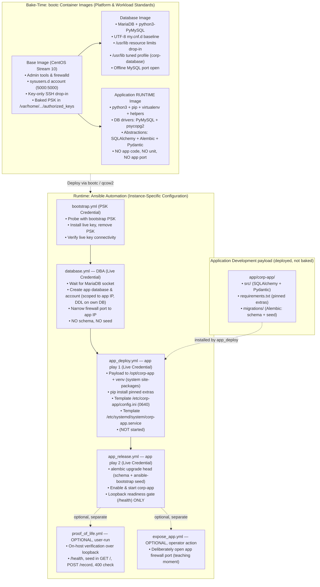

# Architecture

How the bake-time/runtime boundary is drawn, how images layer across team boundaries, and how the repository mirrors the deployed filesystem.

## Presumed familiarity

The tables below record the baseline this pattern assumes and the areas it actively teaches.

### Familiar by assumption (enterprise baseline — never re-taught)

| Technology | Assumed level | How it shapes this project |
|---|---|---|
| **Ansible** | Expert / Fluent | Roles, task idempotency, `group_vars` precedence, vault encryption, handlers, collections. Playbook syntax and handler mechanics are taken as given. |
| **SSH** | Expert | Key modes (`0600`), `authorized_keys` options tokens (`no-pty`, forwarding controls), fingerprint-based key matching. |
| **systemd** | Expert | Unit drop-ins, `systemctl edit`, sandboxing directives (`NoNewPrivileges`, `ProtectSystem`), `sysusers.d`, and `tmpfiles.d`. |
| **firewalld** | Expert | Zones, rich rules, and runtime vs. permanent state. Only the build-time offline tool (`firewall-offline-cmd`) is treated as new. |
| **PAM & Linux OS** | Working Knowledge | Session flow, limits (`limits.d` vs. systemd service drop-ins), standard RHEL administration. |

### First contact / low familiarity (the pedagogical frontier)

| Technology | Assumed level | How it shapes this project |
|---|---|---|
| **bootc / Image-Mode** | Day-1 Explorer | Actively taught: immutable `/usr`, 3-way merge `/etc`, install-only `/var`, the `/home` → `/var/home` symlink, and image upgrade/rollback semantics. |
| **Containers as OS Images** | Beginner | Application containers may be familiar, but using a Containerfile to build an entire bootable OS image is treated as novel. The `rootfs/` mirror-tree is used to bridge this. |
| **ostree Deployment Semantics** | Zero | Atomic updates, staged deployments, and rollback survival are explained and diagrammed. |
| **Ansible Automation Platform** | Intermediate | Conceptual familiarity with Job Templates and Machine Credentials; credential-isolation constraints under AAP are documented. |

## Why the boundary is drawn where it is

**bootc's `/usr` is immutable at runtime.** Service unit files, executables, sysusers
and tmpfiles declarations, and tuned profiles all live under `/usr/lib`. They update
atomically when the image updates and cannot be edited on a running host. The corporate
standard for *how MariaDB runs* (file-descriptor limits, character set, tuned profile)
lives here so that a `bootc upgrade` automatically propagates it to every host in the
fleet without a separate configuration management run.

**bootc's `/etc` is machine-local config subject to 3-way merge.** The SSH hardening
drop-in, the MariaDB baseline `cnf`, and the application runtime config land here.
Ansible writes instance-specific values (credentials, database host pointer) into
`/etc`; a `bootc upgrade` merges them so local changes survive.

**bootc's `/var` is persistent machine state and first-contact state.** In bootc systems,
`/home` is a symlink to `/var/home` so user data resides on the persistent `/var` volume.
This is why all management account paths reference `/var/home/ansible/`.

Two critical operational guarantees rest on bootc's install-only `/var` semantics:
1. **The pre-shared bootstrap key (PSK) cannot resurrect**: bootc applies `/var` content from
   the image *only* at initial install — it is never re-applied or merged by `bootc upgrade`
   or `bootc rollback`. Once Ansible deletes the PSK, nothing can restore it.
2. **Database data survives updates and rollbacks**: `/var/lib/mysql` is preserved untouched
   across `bootc upgrade` and rollback by the exact same mechanism. The image never overwrites
   existing `/var` data. The guarantee that prevents the PSK from resurrecting is the exact
   same guarantee that keeps your database data safe.

## Bridging traditional automation to image mode

For sysadmins migrating existing monolithic Ansible playbooks, configuration tasks split
across the new boundary as follows:

| Traditional Ansible Task | Where it moves in this pattern | Why |
|---|---|---|
| `dnf`/`package` installation tasks | Containerfile `RUN dnf install` | Packages live in immutable `/usr`; no package manager runs at runtime |
| Base OS hardening (SSH, sudoers) | Base image `rootfs/etc/` | Applied identically across all fleet hosts at bake time |
| Management user creation | Base image `usr/lib/sysusers.d/` | Idempotent, drift-free boot-time account creation with pinned UID/GID |
| Service units & resource limits | Workload image `usr/lib/` | Image-owned standard; updates atomically with image upgrades |
| Service baseline config (`my.cnf.d`) | Workload image `rootfs/etc/` | Seeded at install time; merges cleanly via bootc 3-way merge |
| Firewall port baseline | Workload image (`firewall-offline-cmd`) | Offline baseline opened during container build |
| Runtime firewall narrowing (rich rules) | Ansible (`ansible.posix.firewalld`) | Instance-specific; restricts DB access to application VM IP |
| Application code + Python extras | Ansible (`app_deploy`: payload to `/opt/corp-app`, pip into venv) | App is a payload on the runtime baseline; pinned extras only |
| Application schema & migrations | Ansible (`app_release`: Alembic from the venv) | App owns its schema; DBA provides the empty database |
| Application config & credentials | Ansible (templates & vault in `/etc`) | Instance-specific state that differs across environments |
| Service unit file | Ansible (`app_deploy`: template to `/etc/systemd/system`) | Instance-owned unit; not baked into the image |
| Service start and enablement | Ansible (`app_release`: `ansible.builtin.systemd`) | Deferred until payload, config, and schema are in place |
| External firewall exposure | Ansible, deliberate separate step (`expose_app`) | Default-deny until a human explicitly exposes the service |

## Visualizing the architecture



## Image layering is the team boundary

Layering via `FROM corp-base:latest` is the organisational boundary: Infrastructure / Operations
owns the base image; workload teams derive from it. No multi-stage Containerfile
builds are needed — nothing is compiled. Each layer adds only what its workload requires.

Note the ownership nuance on the application side: **Middleware** owns
the `corp-app` runtime baseline (the corporate Python stack), while the **Application Development**
team owns the application payload deployed onto it (`app/corp-app/` → `/opt/corp-app`).
The image answers "what Python runtime does every app host get?"; the payload answers
"what is *this* app?".

## The `rootfs/` mirror-tree convention

Image directories that ship baked configuration contain a `rootfs/` subtree that mirrors
the target filesystem. The single Containerfile step `COPY rootfs/ /` copies it all in one
layer. This convention makes the build context the documentation of what lands where on a
deployed system — you can navigate `images/base/rootfs/` to understand the deployed state
without reading Containerfile logic.

The **application runtime image is the deliberate exception**: it has no `rootfs/` because it
bakes no files of its own beyond the packages it installs — it is a pure runtime baseline.
Everything app-specific is a payload Ansible deploys to `/opt/corp-app` at runtime.

```
images/base/rootfs/
├── etc/
│   ├── sudoers.d/99-ansible                          → /etc/sudoers.d/99-ansible
│   └── ssh/sshd_config.d/50-corporate-hardening.conf → /etc/ssh/sshd_config.d/
├── var/
│   └── home/ansible/.ssh/authorized_keys            → PSK, first-contact only
└── usr/lib/
    ├── sysusers.d/ansible.conf                       → management account, UID 5000
    └── tmpfiles.d/ansible-home.conf                  → home dir (d entries only)
```

## Repository layout

```
ansible-bootc/
├── README.md
├── docs/
│   ├── architecture.md                       This document
│   ├── psk-lifecycle.md                      PSK lifecycle and key-generation ordering
│   ├── day2-operations.md                    Change routing and upgrade safety
│   ├── application-design.md                 Application standard, deploy/release, firewall
│   ├── aap-compatibility.md                  Running under Ansible Automation Platform
│   ├── troubleshooting.md                    Failure modes and security non-additions
│   └── project/
│       └── requirements.md                   Canonical normative requirements and acceptance criteria
├── scripts/
│   ├── setup-demo-host.sh                    Automated local demo setup (host packages, libvirt, VMs)
│   └── generate-demo-keys.sh                 MUST run before any image build
├── images/
│   ├── base/
│   │   ├── Containerfile
│   │   └── rootfs/                           Mirrors /; COPY rootfs/ / installs all
│   │       ├── etc/sudoers.d/99-ansible
│   │       ├── etc/ssh/sshd_config.d/50-corporate-hardening.conf
│   │       ├── var/home/ansible/.ssh/authorized_keys   ← gitignored, generated
│   │       └── usr/lib/
│   │           ├── sysusers.d/ansible.conf
│   │           └── tmpfiles.d/ansible-home.conf
│   ├── database/
│   │   ├── Containerfile
│   │   └── rootfs/
│   │       ├── etc/my.cnf.d/00-corporate.cnf
│   │       └── usr/lib/
│   │           ├── systemd/system/mariadb.service.d/10-corporate.conf
│   │           └── tuned/corp-database/tuned.conf
│   └── application/                          Corporate Python RUNTIME baseline
│       └── Containerfile                     No rootfs/: bakes no app code or unit
├── app/                                      Application Development payload (deployed to /opt/corp-app)
│   └── corp-app/
│       ├── requirements.txt                  App-specific pinned EXTRAS only
│       ├── src/                              Application package (SQLAlchemy + Pydantic)
│       └── migrations/                       Alembic tree (app-owned schema + seed)
└── ansible/
    ├── ansible.cfg                           Run from ansible/ directory
    ├── requirements.yml                      ansible.mariadb, ansible.posix
    ├── site.yml                              Deployment entrypoint (bootstrap → database → app_deploy → app_release; NOT proof-of-life)
    ├── inventory/
    │   ├── hosts.yml                         db01, app01 — update IPs here
    │   └── group_vars/
    │       ├── all/vars.yml                  Shared non-sensitive vars
    │       ├── all/vault.yml                 app_db_password (vault-encrypted)
    │       ├── database/vars.yml             app_host_address
    │       └── application/vars.yml          db_host, app_port, app_root/app_venv/app_src/app_entrypoint
    ├── keys/                                 Generated key material — all gitignored
    ├── playbooks/
    │   ├── bootstrap.yml                     PSK probe → rotation → live key verify
    │   ├── database.yml                      DBA: DB foundation (no schema/seed)
    │   ├── app_deploy.yml                    App play 1: payload/venv/config/unit
    │   ├── app_release.yml                   App play 2: migrate + start + readiness gate
    │   ├── proof_of_life.yml                 On-host verification: health, read, write
    │   └── expose_app.yml                    Operator action: open external firewall port
    └── roles/
        ├── bootstrap_key_rotation/           PSK → live key rotation
        ├── mariadb_instance/                 DB + account + firewall narrowing (schema-free)
        ├── app_deploy/                       Payload, venv, pinned extras, config, unit
        ├── app_release/                      Alembic migrate, enable/start, readiness gate
        └── app_proof_of_life/                On-host functional verification over loopback (exercise)
```

## Team split: layering is the boundary

The `FROM corp-base:latest` line in the database and application Containerfiles is
literally the team boundary in code. Infrastructure / Operations publishes `corp-base`;
workload teams pull from it and add their layer. No multi-stage build stages are
needed — nothing in this pattern is compiled, so there is no "build artefact"
separation requirement. The layered `FROM` is the full story.

On the application side there is a second boundary *inside* the layer: **Middleware**
owns the `corp-app` runtime baseline (the corporate Python
stack), while **Application Development** owns the payload (`app/corp-app/`) that Ansible deploys to
`/opt/corp-app`. The image answers "what runtime does every app host get?"; the payload answers
"what is this app?". The DBA owns `corp-db` and the DB foundation play.

## Service tuning: `/usr/lib/` placement and why `limits.d` does not work

The `mariadb.service` resource-limit drop-in lives at
`usr/lib/systemd/system/mariadb.service.d/10-corporate.conf` in the database image's
`rootfs/`. This is the image-owned location. The corporate standard —
`LimitNOFILE=65536`, `LimitNPROC=4096` — updates unconditionally with the image.

**Why not `/etc/systemd/system/`?** The `/etc/` location is machine-local config
subject to 3-way merge. Placing the corporate standard there would mean Ansible has to
enforce it at runtime, and an operator `systemctl edit mariadb` drop-in would have to
fight with it. The `/usr/lib/` location is clean: image owns the baseline, operators
layer instance-specific overrides via `systemctl edit` into `/etc/`.

**Why not PAM `limits.d`?** PAM limit files apply only to login sessions that pass
through PAM. `mariadb.service` is started by systemd and bypasses PAM entirely. A
`/etc/security/limits.d/mariadb.conf` entry has zero effect on the database process.
The unit drop-in is the correct and only reliable mechanism for enforcing resource
limits on a systemd-managed service.

The same reasoning applies to the `corp-database` tuned profile: it lives under
`usr/lib/tuned/corp-database/tuned.conf` (image-owned), inherits from
`throughput-performance` (the platform baseline), and adds database-specific settings
(THP disabled, swappiness minimised, dirty-ratio raised, read-ahead configured). The
Containerfile activates it by writing `corp-database` to `/etc/tuned/active_profile`
at build time; `tuned-adm` requires a running daemon and cannot be used in a
Containerfile.

## Package rationale

| Package | Image | Reason |
|---------|-------|--------|
| `sudo` | base | Ansible `become: true` without a password; NOPASSWD:ALL in `99-ansible` |
| `openssh-server` | base | SSH daemon; key-only management |
| `python3` | base | Ansible module runtime |
| `rsync` | base | Ansible file-transfer backend |
| `iproute` | base | Operator tools: `ip`, `ss` |
| `firewalld` | base | Firewall daemon; offline config at build time |
| `tuned` | base | Platform tuning daemon |
| `tmux` | base | Persistent debug sessions for operators |
| `vim-minimal` | base | In-place editing of host config |
| `bind-utils` | base | DNS lookups (`dig`, `host`) |
| `mariadb-server` | database | Database engine |
| `mariadb` | database | Client CLI for local administrative access (root via unix socket) |
| `python3-PyMySQL` | database | Required by the `ansible.mariadb` Ansible modules AND any local DB client work |
| `mariadb-backup` | database | DBA physical backup/recovery — frequently needed, host-coupled |
| `lsof`, `strace`, `procps-ng`, `sysstat` | database | DBA host diagnostics (open files, syscalls, `ps`/`vmstat`, `iostat`/`sar`) |
| `jq` | database | JSON inspection for logs/API output |
| `python3`, `python3-pip` (RPM); `virtualenv` (pip) | application | Corporate Python runtime core: interpreter + venv tooling for app deployment |
| `ca-certificates`, `tzdata` | application | TLS trust and timezone data for the runtime baseline |
| `git`, `tar`, `gzip`, `unzip` | application | Helper tooling for payload/artifact handling |
| `python3-setuptools` (RPM); `wheel` (pip) | application | Python packaging support |
| `python3-PyMySQL`, `python3-psycopg2` | application | Corporate DB driver set (MariaDB/MySQL + PostgreSQL) — standardized centrally |
| `SQLAlchemy`, `Alembic`, `Pydantic` | application | Corporate data-abstraction layer (RPM where packaged, else pinned build-time pip) |

**Corporate operator tooling, not baked (break-glass):** `tcpdump` and other episodic or
high-privilege diagnostics are deliberately **excluded** from the images. Use a one-shot container
or a documented, transient manual `dnf install` during an incident. This keeps packet capture off
every host by default (a smaller standing attack surface) while remaining a known break-glass path.

**Runtime package policy.** Ansible never installs or updates **OS** packages — a `dnf install` in
an Ansible task is a design violation. The one deliberate exception is **application Python
dependencies**: `app_deploy` may `pip install` the app's *pinned extras* into the app venv at
`/opt/corp-app/venv`. The corporate Python stack (drivers + SQLAlchemy/Alembic/Pydantic) is baked
into the runtime image and inherited by the venv (`--system-site-packages`), so runtime pip is
limited to genuinely app-specific libraries, always pinned, never into system site-packages.
