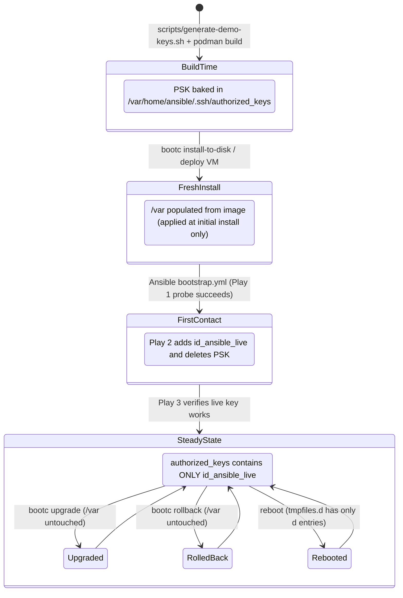

# PSK Lifecycle

The pre-shared bootstrap key's lifecycle, the key-generation ordering constraint, and the policies that keep it from returning.

The pre-shared bootstrap key (PSK) is the sole mechanism for reaching a freshly
provisioned, never-onboarded host. Its lifecycle is invariant:

| Phase | `authorized_keys` state | Mechanism |
|-------|------------------------|-----------|
| Image build | PSK entry (with restrictive options), owned `5000:5000`, mode `0600` | `scripts/generate-demo-keys.sh` writes the file; Containerfile sets ownership/mode |
| First boot | PSK entry present and usable | bootc applies `/var` tree at initial install only |
| After `bootstrap.yml` | Live key only; PSK absent | `bootstrap_key_rotation` role installs live key, removes PSK |
| `bootc upgrade` | Unchanged (live key only) | `/var` is never merged or re-applied by bootc upgrade |
| Reboot | Unchanged | `tmpfiles.d` has only `d` entries for `.ssh/`; existing files are not recreated |
| Re-run `bootstrap.yml` | Unchanged | Play 1 probe fails (PSK gone); Play 2 skipped; Play 3 verifies live key still works |
| Stale host (old image, new PSK generated) | Cannot be onboarded | Decommission and reprovision; never rescued |

**Re-run console output note:** When re-running `bootstrap.yml` against an already-onboarded
host, Play 1's recap will report `unreachable=1` in red. **This is expected and designed behavior**:
because the PSK was removed at first contact, probing with the bootstrap key fails authentication.
The task specifies `ignore_unreachable: true`, which skips Play 2's rotation and allows Play 3 to
verify live-key connectivity. The UNREACHABLE status in Play 1 is the discriminator, not an outage.

**Why not cloud-init?** Cloud-init or metadata services are common in public clouds for initial key
injection. The baked-PSK pattern is valuable where cloud-init is unavailable, undesirable, or
fragmented: air-gapped environments, bare-metal physical servers, or heterogeneous hypervisors.
It exploits bootc's native install-only `/var` semantics to guarantee first-contact-only access
with zero external agents or boot-time infrastructure.



```text
  Phase:           Image Build        First Boot          First Contact (Ansible)    Day-2 (Upgrades / Rollback)
                  ─────────────      ────────────        ────────────────────────    ───────────────────────────
  Host /var:      [PSK baked]   ──►  [PSK unpacked]  ──► [PSK removed, Live added] ──► [Live key retained; /var untouched]
                                                                  ▲
  Ansible Node:   [Keys generated]   [Wait for IP]   ──► [bootstrap.yml runs]   ──► [Subsequent plays use Live key]
```

## No resurrection path

After rotation, **nothing re-creates the PSK entry** — not upgrades, not reboots,
not re-running playbooks. The only way to restore first-contact behaviour is a fresh
provisioning from the image (which re-applies `/var`). This is the "install-only `/var`
semantics" guarantee.

## Restrictive SSH options on the PSK line

The PSK entry in `authorized_keys` carries four SSH option tokens:

```
no-pty,no-X11-forwarding,no-agent-forwarding,no-user-rc ssh-ed25519 AAAA...
```

These limit what the shared provisioning key can do:

| Option | Restriction |
|--------|-------------|
| `no-pty` | No interactive terminal — Ansible's non-interactive command execution does not require one |
| `no-X11-forwarding` | No X11 session forwarding |
| `no-agent-forwarding` | No SSH agent forwarding |
| `no-user-rc` | Do not execute `~/.ssh/rc` on login |

Ansible's `authorized_key` module matches keys by fingerprint and correctly identifies
and removes the PSK entry even though it carries this options prefix.

## Expected `bootc container lint` warning

Running `bootc container lint` on the base image will produce a warning about content
under `/var`:

```
WARN: Image contains content under /var — bootc expects /var to be managed at
      runtime by the host, not baked into the image.
```

**This warning is intentional, not a defect.** (Note: exact phrasing varies across
`bootc container lint` toolchain releases; any warning flagging files or content under `/var`
references this intentional PSK placement). The PSK must live under `/var` because
that is the only bootc filesystem zone with "applied at initial install only, never
re-applied on upgrade" semantics — exactly what the first-contact-only lifecycle
requires. The alternatives (tmpfiles.d `f~` entry, `/etc` with Ansible cleanup) all
introduce a resurrection path that would defeat the guarantee. The warning is documented
here so operators know to expect it and need not investigate.

## Key Generation → Image Build Ordering

**The key generation script must run before any image build.** This is a hard ordering
constraint, not a suggestion:

```
scripts/generate-demo-keys.sh       ←  MUST come first
    ↓
podman build -t corp-base:latest images/base/
    ↓
podman build -t corp-db:latest images/database/
    ↓
podman build -t corp-app:latest images/application/
```

**Why the order matters:** `scripts/generate-demo-keys.sh` writes the bootstrap public
key into `images/base/rootfs/var/home/ansible/.ssh/authorized_keys`. The base
Containerfile copies that file into the image layer (`COPY rootfs/ /`). If you build
the image first and generate the keys after, the image contains no `authorized_keys`
file (the build actually fails with an explicit error) — or worse, if a previous
`authorized_keys` was present, the image and the Ansible key material are out of sync
and newly provisioned hosts cannot be onboarded.

**What happens if you regenerate keys after provisioning:** Any host already provisioned
from an image built with the old PSK becomes unreachable with the new bootstrap key.
The script guards against this by refusing to overwrite existing keys:

```
ERROR: Keys already exist in ansible/keys/.
       Regeneration would invalidate all images built with the current
       bootstrap key. Hosts provisioned from those images cannot be
       onboarded with a new PSK and must be decommissioned and
       reprovisioned from a freshly built image.
```

## Shared PSK: intentional design and blast radius

One bootstrap key pair per image build covers first-contact access for the entire
fleet built from that image. The blast radius of a compromised PSK is limited to
unprovisioned hosts only — once a host is onboarded, the PSK is gone and the live
key is the sole management path.

Rotating the PSK means rebuilding the base image (which requires re-running
`scripts/generate-demo-keys.sh`, rebuilding the base image, and reprovisioning new
hosts from the new image). Stale hosts — provisioned from an older image with the old
PSK, not yet onboarded — cannot be bootstrapped with a new PSK. The stale-host
policy is clear: decommission and reprovision from the current image. There is no
rescue path.

## PSK lifecycle and the no-resurrection guarantee

The PSK lives under `/var` because bootc applies `/var` at initial install only. Nothing
in this design recreates the PSK after rotation:

- **`bootc upgrade`** — does not re-apply `/var`; the live key survives unchanged.
- **Reboots** — `tmpfiles.d/ansible-home.conf` contains only `d` (directory create)
  entries for `.ssh/`. A `d` entry on a directory that already exists is a no-op;
  existing files (including `authorized_keys`) are never touched.
- **Re-running `bootstrap.yml`** — Play 1 fails to authenticate via PSK (it is
  already gone); Play 2 skips rotation (gated on explicit probe success); Play 3
  confirms the live key still works. `authorized_keys` is left unchanged.
- **Rollback** — if a host rolls back to a previous image, `/var` is not re-applied;
  the live key remains.

This is the "install-only `/var` semantics" guarantee, and it is the reason the PSK
must live under `/var` rather than in a `tmpfiles.d` `f~` entry or any other mechanism
that would reintroduce a resurrection path.

## Stale-host policy

An unprovisioned host that outlives a PSK rotation (i.e., a host provisioned from an
old image after the key material has been regenerated) must be **decommissioned and
reprovisioned from the current image**. There is no way to onboard such a host: the
new PSK is not in the old image, and there is no interactive login path and no fallback
credential. The design accepts this constraint as the price of the no-resurrection
guarantee.

## No interactive login path: intentional design

The SSH hardening drop-in (`50-corporate-hardening.conf`) sets `AllowUsers ansible`.
This means:

- No root SSH login (`PermitRootLogin no`).
- No password authentication (`PasswordAuthentication no`).
- No SSH access for any account other than `ansible`.
- A fresh VM has no interactive login path for any human operator.

This is intentional. Break-glass access is:

1. **Live key** — the normal management path after onboarding.
2. **Full re-provisioning** — the recovery path if the live key is lost after rotation.

A host whose live key is lost after bootstrap rotation must be re-provisioned. There is
no fallback credential, and that is by design: a fallback credential would be a
persistent attack surface on every host in the fleet.
